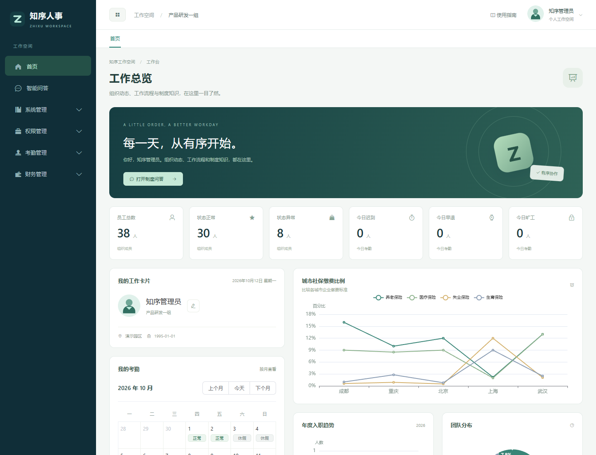
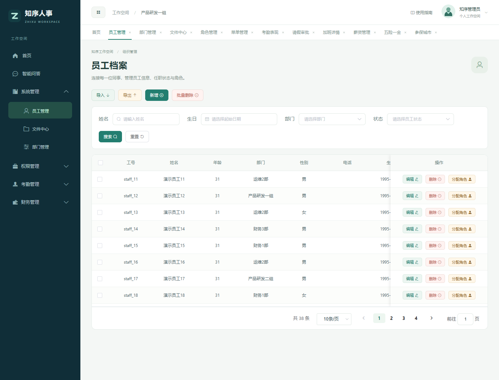
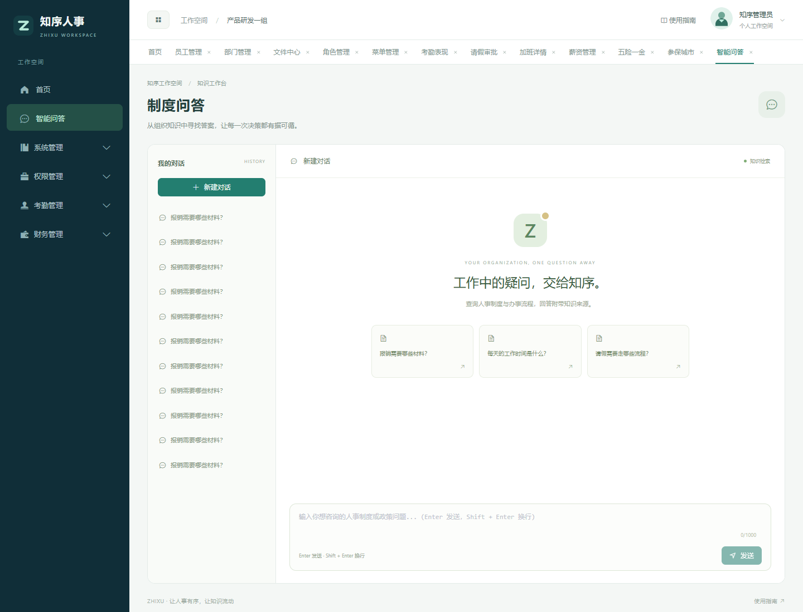

# 知序人事 · ZHIXU

让人事有序，让知识流动。连接组织、流程与知识的企业人事工作空间。

项目仓库：[tclear450-max/zhixu-admin](https://github.com/tclear450-max/zhixu-admin)。仓库包含完整前后端，前端位于 `zhixu-admin`，后端位于 `zhixu-server`。

知序人事是一套面向企业的人事协作平台，覆盖员工档案、组织架构、考勤审批、薪资管理与制度问答，提供统一的工作空间和可复现的本地运行环境。

业务 UI 已统一为知序视觉：深青导航、浅色工作区、青绿色操作、模块标题、工作总览与制度问答。桌面表格与编辑弹窗重新整理，手机使用抽屉导航及横向表格；新版界面截图见 `delivery/知序UI-*.png`。







## 直接体验

在 Windows 上双击 **start.bat**。已构建的交付包只需 Docker Desktop；源码首次构建还需要 Java 17+、Maven 3.9+、Node.js 20+。首次启动需要联网拉取镜像及构建 MinIO，后续启动使用本地缓存。

```powershell
git clone https://github.com/tclear450-max/zhixu-admin.git
cd zhixu-admin
.\start.bat
```

- 系统：http://localhost:18080/login
- 操作指南：http://localhost:18080/guide.html
- 管理员：`admin` / `Zx@123456`，验证码按图片输入
- 人事审批：`staff_9`；主管审批：`staff_2`；员工：`staff_3`，演示密码均为 `Zx@123456`
- 停止：双击 **stop.bat**，数据保留

完整步骤见 [使用说明](使用说明.md)，修改源码后用 `powershell -ExecutionPolicy Bypass -File .\start.ps1 -Rebuild` 构建启动。

## 已包含的能力

| 领域 | 功能 |
|---|---|
| 组织 | 部门树、员工档案、角色与菜单权限 |
| 考勤 | 打卡、日历、考勤分析、加班与调休 |
| 审批 | Flowable 人事审批 → 主管审批、驳回与撤销 |
| 薪资 | 薪资明细、扣款、参保城市、五险一金配置 |
| 知识 | 分片上传、对象存储、文档解析与切块、向量与关键词检索 |
| 问答 | 员工背景、历史会话、SSE 回答、引用来源 |
| 交付 | 自动初始化、随机环境凭据、独立端口、持久化卷、健康检查 |

演示模式使用确定性的 1024 维字符哈希向量与文档原文提取，**不是生成式模型**。Java 后端、数据库、上传、检索和会话均使用实际服务。正式 DashScope 模型的接入步骤在使用说明中。

## 结构

```text
zhixu-admin/         Vue 2 / Element UI，知序视觉与业务页面
zhixu-server/        Java 17 / Spring Boot / Flowable / Spring AI
db/                 数据库结构与初始化脚本
delivery/           交付配置、本地模型适配器、演示制度与验证工具
compose.delivery.yaml  独立 Docker 编排
start.bat / start.ps1   自动配置、构建和启动
stop.bat               停止服务，保留数据
使用说明.md            操作、开发、模型接入和排障
THIRD_PARTY.md         组件与许可证说明
```

## 许可证

本项目采用 GPL-3.0 许可证，详见 [LICENSE](LICENSE)。第三方组件说明见 [THIRD_PARTY.md](THIRD_PARTY.md)。
